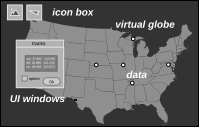
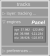

# ODIN Web Client/Server Interaction

The `SpaServer` and its `SpaServices` are only half of the story. Since they serve (static and dynamic) data
we still need to visualize and control the data on user machines. To avoid the need for any end-user install we
use standard HTTP, HTML, Javascript and JSON messages over websockets for this purpose.

While `SpaServer` and `SpaService` are generic and can be used for many different web pages/applications the
main end-user visualization we target is a single web page showing geospatial data in application specific layers. 



The four items within this UI are:

- icon box
- UI windows (with UI components)
- virtual globe
- data entities

The icon box contains icons that launch associated UI windows. There is an icon/window pair for each data layer
that can be displayed, plus some pairs for general functions such as clocks, settings and layer control.



The UI windows serve a dual purpose: they can be used for alphanumeric display of data and they hold user interface
components to control what data is displayed and how it is rendered. UI windows normally contain vertically stacked, 
expandable *panels* for different functional areas within the layer. Panels hold related *UI components*

The windows are shown on top of a 3D virtual globe background that uses WebGL to render both static maps and
dynamic data entities such as track symbols or weather information. Data entities are geometric constructs
such as points, lines and polygons, or symbols/icons representing data items.

To change the virtual globe view and move or switch between UI windows we use the following mouse and key commands:

- left-click + drag : pan globe view
- scroll wheel / swipe up/down : zoom globe view in/out   
- ctrl + left-click + drag : tilt and rotate globe view
- alt + left-click : center globe view on cursor position
- alt + arrow-left/arrow-right or arrow-up/arrow-down :  move center of globe view left/right or up/down
- alt + home : pan/zoom back to home (initial) globe view
- alt + page-down : reset to orthogonal view angle (towards center of earth)
- alt + 1/2/3/4/5/6 : zoom globe view to (`odin_cesium_config.js` configured) camera height levels
- alt + 'i'/'o' : zoom globe view in/out
- esc : reset entity selection indicator (the green rectangle around selected objects)
- alt + left-click in titlebar of ui window : move window to the left 
- alt + 'l'/'r' or 't'/'b' : move top window to left/right or top/bottom
- alt + 'n'/'p' : cycle forwards/backwards through ui windows


### 3.1 DOM

The underlying DOM is assembled by `odin_server::SpaComponents::to_html()` based on the components that were collected
from each of the configured `SpaService` implementations of the application. It has the following structure:

```html
<html>
    <head>
        <!-- collected head fragments  -->
        <link rel="stylesheet" type="text/css" href="./asset/odin_server/ui.css"/>>
        <script type="module" src="./asset/odin_server/main.js"></script>
        <script type="module" src="./asset/odin_goesr/odin_goesr.js"></script>
        ...
    </head>

    <body>
        <!-- collected body fragments  -->
        <div id="cesiumContainer" class="ui_full_window"></div>
        ...

        <!-- post init script  -->
        <script type="module">
            import * as main from './asset/odin_server/main.js';
            if (main.postInitialize) { main.postInitialize(); }
            import * as odin_goesr from './asset/odin_goesr/odin_goesr.js';
            if (odin_goesr.postInitialize) { odin_goesr.postInitialize(); }
            ...
        </script>
    </body>
</html>
```

Head fragments can contain link elements (for CSS) and script elements (for JS scripts and modules). 
This is collected from the `SpaService::add_components()` implementations of the configured services.
`SpaServices` normally have an associated JS module, stored in the `asset/` dir of the containing crate, e.g

```
    odin_goesr/
      assets/
         odin_goesr_config.js       optional, if there is static config of odin_goesr.js
         odin_goesr.js              the JS module associated with the SpaService
      src/      ⬆︎         
         goesr_service.rs           the SpaService implementation that adds odin_goesr.js to the document
```

The first included JS module is always the automatically added `main.js`, which is provided as an asset by the 
`odin_server` crate, there is no need to add it to `add_dependencies()` implementations of `SpaServices`. Its 
main purpose is to define types and access APIs for data that can be shared between Javascript modules and users
(e.g. `GeoPoint`). 

Please note `main.js` module only provides a local storing mechanism, i.e. if no other `SpaService` such as 
[`odin_share`](../odin_share/odin_share.md)`::ShareService` is configured it will only allow to share data between micro 
services (layers) running within the same browser document.

The document construction ensures that each configured JS module is loaded just once in the order of first reference as 
odin-rs modules normally depend on each other (specified by their `SpaService::add_dependencies()` implementation).

Body fragments are not restricted and can contain whatever HTML elements are required by their `SpaServices`.

Following the body fragment section is a script that calls `postInitialize()` of each loaded JS module that contains
such a function. This is used for code that has to run after all modules have been initialized. Modules
might be async and hence we cannot rely on their static order to guarantee completed initializatin.

If `SpaService` impls do have dependencies and components such as JS modules those have to be
specified in the `SpaService` trait function, as shown in the `GoesrService` example below:

```rust
#[async_trait]
impl SpaService for GoesrService {

    fn add_dependencies (&self, spa_builder: SpaServiceList) -> SpaServiceList {
        spa_builder.add( build_service!( => CesiumService::new())) // recursive dependency graph
        ...
    }

    fn add_components (&self, spa: &mut SpaComponents) -> OdinServerResult<()>  {
        spa.add_assets( self_crate!(), load_asset);          // all icons and other resources used by JS module
        spa.add_module( asset_uri!("odin_goesr_config.js")); // module with static config
        spa.add_module( asset_uri!( "odin_goesr.js" ));      // service specific JS module itself
        ...
        Ok(())
    }
    ...
}
```


#### Assets are public - they must not contain sensitive data

All `asset/...` resources (JS modules, CSS, images, static config modules such as `odin_goesr_config.js`) are served
without authentication, even if the server uses [user authentication](auth.md). The login document of such servers
*preloads* all local assets of the application document (`<link rel="modulepreload">` for JS modules, `<link
rel="preload">` for scripts) so that the application loads faster once the user is authenticated. This means:

- **JS modules and other assets must not contain sensitive data** (credentials, access tokens, non-public
  locations, personal information etc.). They should only contain code and static, public configuration.
- Sensitive or user specific data has to be sent through the websocket (which requires an authenticated session) or
  served from routes that are protected with `SpaComponents::add_protected_route(..)`.
- Proxied resources (`proxy/...`) require an authenticated session by default (see `protect_proxies` in
  [auth](auth.md)) and are hence not preloaded.

Asset responses carry an `ETag` and `Cache-Control: no-cache`, i.e. browsers reuse cached (preloaded) assets after a
cheap revalidation request, and changed assets are picked up on the next document load.

### 3.2 Client (Browser) Code

Although there is no need for a specific structure or purpose of a JS module the ones implementing UI windows
and websocket message processing follow the convention laid out in the `odin_goesr.js` example below:

```javascript

//--- 1. import JS module configuration
import { config } from "./odin_goesr_config.js";              // associated static config for this module

//--- 2. import other JS modules
import * as main from "../odin_server/main.js";               // global functions (e.g. for data sharing)
import * as util from "../odin_server/ui_util.js";            // common, cross-module support functions
import * as ui from "../odin_server/ui.js";                   // ODIN specific user interface library 
import * as ws from "../odin_server/ws.js";                   // websocket processing
import * as odinCesium from "../odin_cesium/odin_cesium.js";  // virtual globe rendering interface from odin_cesium
... 

//--- 3. constants
const MOD_PATH = "odin_goesr::goesr_service::GoesrService";   // the name of the associated odin-rs SpaService 
...

//--- 4. registering JS message handlers
ws.addWsHandler( MOD_PATH, handleWsMessages);                 // incoming websocket messages for MOD_PATH
main.addShareHandler( handleShareMessage);                    // if module uses shared data items
main.addSyncHandler( handleSyncMessage);                      // if module supports synchronization commands

//--- 5. data type definitions, module variable initialization
...
var dataSets = [];                                            // module data
var dataSetView = undefined;                                  // module global UI components
var selectedDataSet = undefined;                              // keeping track of user selections
...

//--- 6. UI initialization
createIcon();
createWindow();                                               // UI window definition
initDataSetView();                                            // initialize UI window components and store references
...

console.log("odin_goesr initialized");

//--- 7. function definitions
...
function createIcon() {                                       // define UI window icon (used to automatically populate icon box)
    return ui.Icon("./asset/odin_goesr/geo-sat-icon.svg", (e)=> ui.toggleWindow(e,'goesr'));
}

function createWindow() {                                     // define UI window structure and layout
    return ui.Window("GOES-R Satellites", "goesr", "./asset/odin_goesr/geo-sat-icon.svg")(
        ui.LayerPanel("goesr", toggleShowGoesr),              // panel with module information (should be first)
        ...
        ui.Panel("data sets", true)(                          // (collapsible) panel definition
            ui.RowContainer()(
                ui.CheckBox("lock step", ...),
                ...
                (dataSetView = ui.List("goesr.dataSets", 6, selectGoesrDataSet)),
                ...
            )
        ),
        ...
        ui.Panel("layer parameters", false)(                 // panel with display parameter controls (should be last)
            ui.Slider("size [pix]", "goesr.pointSize", ...)
            ...
        )
    );
}

function initDataSetView() {                                 // UI component init 
    let view = ui.getList("goesr.dataSets");
    if (view) {
        ui.setListItemDisplayColumns(view, ["fit", "header"], [    // defines List columns and display
            { name: "sat", tip: "name of satellite", width: "3rem", attrs: [], map: e => e.sat.name },
            { name: "good", tip: "number of good pixels", width: "3rem", attrs: ["fixed", "alignRight"], map: e => e.nGood },
            ...
        ])
    }
}

function selectGoesrDataSet(event) {                         // UI component callback
    let ds = event.detail.curSelection;
    if (ds) {
        selectedDataSet = ds;                                // update selected items
        ...
    }
}

function handleWsMessages(msgType, msg) {
    switch (msgType) {
        case "hotspots": handleGoesrDataSet(msg); break;
        ...
    }
}

function handleGoesrDataSet (hotspots) {
    ...
    dataSets.push( hotspots);                                // update data
    ui.setListItems( dataSetView, displayDataSets);          // update UI components displaying data
    ...
}

function handleShareMessage (msg) {                          // shared data updates (local and between users)
    if (msg.setShared) {
        let sharedItem = msg.setShared; ...
    }
    ...
}

function handleSyncMessage (msg) {                           // user interface sync (between users)
    if (msg.updateCamera) { ... }
}
...                                                          // more module functions


//--- 8. global post JS module initialization
export function postInitialize() {                            // optional but needs to be named 'postInitialize`  
    ...
}
```

Not all JS modules need all these sections. All functions (except postInitialize) are module private and can be named
at will, although we encourage to use above conventions so that modules are more easy to read.

**JS modules must not have top level await points (neither explicit nor implicit) before their UI initialization.** JS
modules are evaluated in the order in which the respective `SpaService`s are added to the server (dependencies first),
and this determines the order of icons and windows. Evaluation of a module only starts after all of its (static) imports
are evaluated. If any module in this import graph contains a top level `await` (e.g. `const viewer = await odinCesium.viewerReadyPromise;`)
all modules that directly or indirectly import it become asynchronous - their evaluation is suspended at this point while
the browser continues with the following modules. Since such promises typically resolve late (e.g. after the virtual globe
has been initialized) the respective `createIcon()` calls are executed after all other modules, i.e. their icons show up
at the end of the icon box regardless of service order. Note this also applies to support modules that are imported but do
not create their own UI (such as `odin_cesium/editor.js` or `odin_wind/windfield.js`).

Code that depends on asynchronously initialized resources should either use promise callbacks:

```javascript
odinCesium.viewerReadyPromise.then( (viewer) => {           // no top level await
    viewer.camera.moveEnd.addEventListener( endViewChange);
});
```

or resolve them when they are actually used (e.g. from UI callbacks, which can only be executed after module initialization).
Asynchronous functions (`async function ..`) and `await` *within* functions are fine as long as they are not awaited at the
top level of the module.

If a module requires static initialization that can change independently of the code this should go into a separate
`<module-name>_config.js` asset that is kept either outside the repository in the `ODIN_ROOT/asset/` directory tree or
(if it has sensible non-application specific defaults) in the respective `assets/` directory of the crate that provides
the service. Although there can be some code (and even imports) config modules should be restricted to exporting a 
single `config` object like so:

```javascript
export const config = {
    layer: {
      name: "/fire/detection/GOES-R",
      description: "GOES-R ABI Fire / Hotspot Characterization",
    },
    pointSize: 5,
    ...
}
```

The functions and UI components used by JS modules are from ODIN's own [`odin_server/assets/ui.js`](odin_server/ui_library.md) library. 
The main reason why we use our own is that most available 3rd party libraries are meant to be for full web pages whereas we
use UI components in floating windows on top of our main display - the virtual globe. This means we have to minimize screen
space for UI components. See [design principles](design_principles.md) for other reasons. 


### 3.3 WebSocket Message Processing

This leaves us the (bi-directional) processing of websocket messages, which is not hard-coded but implemented as a `SpaService` /
JS module pair itself: `odin_server::WsService` and `odin_server/assets/ws.js`.

As a general principle we only exchange JSON messages over the websocket. Each message uses the following JSON format:

```
    { "mod": "<service name>", "<msg-name>": <payload value> }
```

(e.g. `{ "mod": "odin_goesr::GoesrService", "hotspots": [...] }` in the above example). The `mod` field is used on both the
server- and the client-side to filter/route it to its respective service/JS module, i.e. it effectively creates a service
specific namespace for messages. 


#### 3.3.1 `SpaService` websocket handling 

On the server side this entails a `SpaService::handle_ws_msg(..)` implementation for incoming messages (sent by the JS module):

```rust
impl SpaService for MyService {
    ...
    async fn handle_ws_msg (&mut self, 
        hself: &ActorHandle<SpaServerMsg>, remote_addr: &SocketAddr, ws_msg_parts: &WsMsgParts) -> OdinServerResult<WsMsgReaction> 
    {
        if ws_msg_parts.mod_path == ShareService::mod_path() {
            match ws_msg_parts.msg_type {
                "myMessage" => ...
                ...
            }
        }
    }
}
```

The `WsMsgParts` is a helper type that already breaks out the `mod_path`, `msg_type` and `payload` string slices of the incoming
message text.

Sending messages from the service to the client has to go through the `SpaServer`, i.e. is done by sending any one of the 
following actor messages to it:

- `BroadcastWsMsg` sends a websocket message to all currently connected (browser) clients
- `SendAllOthersWsMsg` sends to all but one (usually the sender client) websocket connection
- `SendGroupWsMsg` sends to a explicitly provided set of websocket connections
- `SendWsMsg` sends only to one explicitly specified websocket connection

Each of these types store the websocket message as a generic `String` field, i.e. the message can be assembled manually. To
avoid mistakes and cut boiler plate code we provide a 

```rust
pub struct WsMsg<T>  {
    pub mod_path: &'static str, // this is composed of crate_name/js_module (e.g. "odin_cesium/odin_cesium.js")
    pub msg_type: &'static str, // the operation on the payload
    pub payload: T
}
```

helper construct for serialization that can be used like so:

```rust
   let msg = WsMsg::json(ShareService::mod_path(), "myMessage", payload)?;
   hserver.send_msg( BroadcastWsMsg{ data: msg}).await;
```

The payload serialization/deserialization is usually done by means of the [`serde_json`](https://docs.rs/serde_json/latest/serde_json/) crate.


#### 3.3.2 JS module websocket processing

On the client (browser) side websocket messages come in through the `odin_server/assets/ws.js` JS module (if `odin_server::WsService` is used),
which is responsible for dispatching the message to the JS module that registered for the `mod` property of the message object. 

JS module websocket handlers are functions that take two arguments - the name of the message (a string) and the Javascript object
that is deserialized from the payload value: 

```javascript
   function myHandler (msgTypeName, msgObj) {..}
```
This means deserialization if automatically done in ws.js - the receiving JS module does not have to call `JSON.parse(..)`.

The JS module recipient has to provide the message handler function and register it like so:

```javascript
...
import * as ws from "../odin_server/ws.js";                  
...
const MOD_PATH = "odin_goesr::goesr_service::GoesrService";   // the type name of the corresponding SpaService implementation
...
ws.addWsHandler( MOD_PATH, handleWsMessages);
...
function handleWsMessages(msgType, msgObj) {
    switch (msgType) {
        case "hotspots": ...; break;
    }
}
```

**Handlers for messages that contain the complete data set (e.g. "snapshot") have to be idempotent.** Clients can receive
such messages several times: from `SpaService::init_connection()` upon each websocket (re-)connect (`ws.js` closes the
websocket if the browser tab becomes hidden and re-connects once it is visible again), and from `SpaService::data_available()`
if the server side data gets (re-)initialized while clients are connected. The respective handler therefore has to replace
all previous state - entries, Cesium entities (e.g. with `dataSource.entities.removeAll()`), selections and dependent views -
before processing the message. Otherwise Cesium entities with the same id get added twice, which causes runtime errors.

Note that Cesium data sources created with `odinCesium.createDataSource(..)` can be used immediately, i.e. entities can be
added before the data source is added to the viewer. Websocket messages are only received after all JS modules have been
initialized and the viewer is ready since `ws.js` does not connect before its `postInitialize()` call.

#### 3.3.3 main.js - shared types and operations

The automatically included `main.js` module defines types and APIs for values that can be shared between JS modules (and potentially
with other users if a service such as [`odin_share::ShareService`](../odin_share/odin_share.md) is included in the application). 

JS modules using this functionality have to add a respective import:

```javascript
...
import * as main from "../odin_server/main.js";
...
 ...main.getSharedItem(key)...
```

The shared types are 

- `GeoPoint` and `GeoPoint3` for 2- and 3-dimensional geographic coordinates
- `GeoLine` and `GeoLineString` for geographic polylines
- `LineString3` for [ECEF](https://en.wikipedia.org/wiki/Earth-centered,_Earth-fixed_coordinate_system) (xyz) trajectories
- `GeoRect` for parallel/meridian aligned rectangles of geographic coordinates
- `GeoPolygon` for general geographic coordinate polygons
- `GeoCircle` and `GeoCylinder` for geographic circles and cylinders
- `String` for text data
- `I64` and `F64` for numeric integer and float values
- `Json` for text data that is supposed to be parsed as [JSON](https://en.wikipedia.org/wiki/JSON), i.e. is a 
  "catch-all" format for arbitrary objects

Each of these types has a respective type name constant (e.g. `GEO_LINE`) that can be used to identify the type.

Instances of these types can be shared locally or globally, and are identified through an associated pathname (path elements
separated by '/'). The basic abstraction for this is the `SharedItem(key,isLocal,value)`. Shared values can be further
annotated by having a `comment` and an `owner`.

The abstract storage model for shared items is a general key/value store, i.e. `SharedItems` are identified through their
respective keys (pathnames). 

The main API to access shared items is

- `getSharedItem (key)` - to get a specific shared item with known key
- `getAllMatchingSharedItems (regex)` - to get a set of shared items through key patterns
- `setSharedItem (key, valType, data, isLocal=false, comment=null)` - to create, store and share a value
- `removeSharedItem(key)` - to purge a shared value from the store

Changes to the shared item store are broadcasted to registered listeners, i.e. if a JS module needs to know of such
changes it has to register:

```javascript
...
main.addShareHandler( handleShareMessage);
...
function handleShareMessage (msg) {
    if (msg.SHARE_INITIALIZED) {...} 
    else if (msg.setShared) {...}
    else if (msg.removeShared) {...}
}
```

The sharing mechanism can also be used to synchronize operations such as view changes between users. This is done through
`addSyncHandler( handleSyncMessage)` registration, respective `handleSyncMessage` handlers implementations and
`publichCmd(cmd)` calls for relevant state changes. Since those only make sense / have an effect in a context of a
remote service such as `ShareService` please refer to details in [`odin_share`](../odin_share/odin_share.md).

`main.js` also includes a `addShareEditor (dataType, label, editorFunc)` function that can be used by JS modules to 
register interactove editors for share types such as 'GeoLineString` but this is more of a specialty.

Apart from providing the basic sharing API and types `main.js` can also be used to define document global data through its
`exportFunctionToMain(f)` and `exportObjectToMain(o)` functions, which make their arguments globally available in the DOM
as `window.main.<name>`.


### 3.4 User Authorization in Client Code

If the server uses [authentication](auth.md) the application document is only served to authenticated users, and the
server embeds the user name and roles into the document. JS modules can use the following `ui.js` functions to check
if widgets should be disabled or functions hidden:

```javascript
import * as ui from "../odin_server/ui.js";
...
ui.isUserAuthorized("editor");            // user has role "editor"
ui.isUserAuthorized(["editor","admin"]);  // user has any of the roles
ui.isUserAuthorized();                    // there is an authenticated user
ui.getUserName();                         // name of the user (null if no authentication)
ui.getUserRoles();                        // array of role names (null if no authentication)
ui.isAuthenticationEnabled();
ui.isServiceAuthorized(MOD_PATH);         // user is authorized for the (protected) service of this module
ui.registerUserChangeHandler( (user) => {...}); // roles changed (user is null if the session ended)
```

All `isUserAuthorized(..)` calls return `true` if the server does not use authentication, i.e. modules do not need
to distinguish between servers with and without authentication. The functions are synchronous and can be used during
module initialization (e.g. when creating windows). If an administrator changes the roles of a user the server
notifies connected clients, and `ui.js` updates its user info and calls registered user change handlers.

**Client side checks are only for the user interface.** Authorization is always enforced by the server, which drops
incoming websocket messages that require roles the user does not have (see `SpaService::ws_msg_roles()` in
[auth](auth.md)). Such rejections are reported to the client as an `odin-ws-msg-denied` DOM event:

```javascript
document.addEventListener("odin-ws-msg-denied", (e) => console.warn("not authorized:", e.detail.mod, e.detail.msgType));
```

Services can also be protected as a whole (`SpaService::service_roles()` or the `service_roles` server config). The JS
modules of such services are still loaded for all users (assets are public) but do not receive any data if the user is
not authorized. To completely hide the user interface of such services, modules should only create their icons and
windows if `ui.isServiceAuthorized(MOD_PATH)` returns true:

```javascript
const MOD_PATH = "odin_sentinel::sentinel_service::SentinelService"; // the mod_path of the associated SpaService
...
if (ui.isServiceAuthorized(MOD_PATH)) {
    createIcon();
    createWindow();
    ...
}
```

`isServiceAuthorized(mod, user)` does not require a server round trip - the server embeds the role requirements of
all protected services into the document (`window.odinUser = {name, roles, services: {<mod_path>: [<role>..]}}`), and
the check is done locally against the roles of the user. It returns true if the server does not use authentication or
the service is not protected, i.e. modules do not have to know if (or with which roles) their service is protected -
this is a deployment decision. Use this instead of explicit `isUserAuthorized(role)` calls for service level UI
decisions. Note that only whole services are covered (`"<mod_path>"` keys), not individually protected message types.

The optional `user` argument defaults to the current user info. Role changes do not require a reload: user change
handlers receive the updated user info (the `services` map does not change during a session), which can be used to
create or remove the UI when the service becomes available or unavailable:

```javascript
ui.registerUserChangeHandler( (user) => {
    if (ui.isServiceAuthorized(MOD_PATH, user)) { /* create icon/window if not yet done */ }
    else { /* remove icon/window, clear data */ }
});
``` If the user loses the required roles while connected the server sends a
system message that is dispatched as an `odin-service-revoked` DOM event, upon which the module should clear its data
(if roles are granted the server sends the initial data of the service again):

```javascript
document.addEventListener("odin-service-revoked", (e) => { if (e.detail.mod == MOD_PATH) clearData(); });
```
