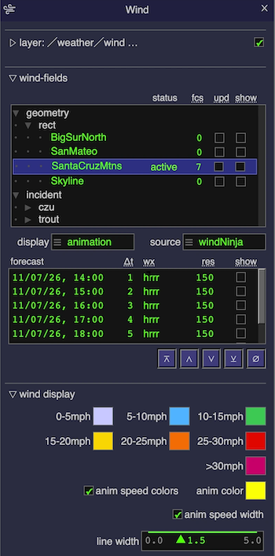

# ODIN Web Client User Interface Library



`odin-rs` comes with its own web client user interface library that provides the common UI widgets (`Window`, `List`, `CheckBox` etc.).
The basic reasons why we do not use available 3rd party libraries is laid out in [design principles](../design_principles.md) but
there are also application specific ones, namely:

(a) UI components have to be compact. Normally UI libraries are for rendering full web pages but in ODIN web applications the main
information is the geospatial display (virtual globe) that forms the background of the page. UI elements should not distract from
this and have to support moving them around. Our use case is much closer to a traditional desktop user interface (inside a browser
page) than it is to normal web page design.

(b) UI widgets have to support structured, dynamic data. The main use of UI components in `odin-rs` web applications is to display
layer specific alphanumeric data that can be dynamically updated through a websocket, and to control the CesiumJS / WebGL
rendering of selected data items. If widgets only work with basic, generic types such as strings and numbers it would require
a large amount of glue/adapter code in respective JS modules of such layers, which would be especially error prone in the context
of layer specific data items that are asynchronously updated at a high rate (e.g. for object tracking). This is particularly addressed
by our `List` widget. 

(c) Theme support. We not only want to support a wide range of display sizes/resolutions and OS platforms (possibly with native UI 
resemblance). Since we also target in-field applications there needs to be the end-user capability to choose between day/night displays
and high/low contrast modes. This requires extensive configuration support both on the server and locally on clients.

The `ui.js` module implements our library as a `odin_server` [asset](../odin_build/odin_build.md). It uses a fairly straight-forward
[DOM](https://developer.mozilla.org/en-US/docs/Web/API/Document_Object_Model) manipulation through Javascript in which each of its
components is represented by a [`DIV`](https://developer.mozilla.org/en-US/docs/Web/HTML/Element/div) element with `odin-rs` specific
class names such as `ui_window` or `ui_list`. The UI layout could be specified in a plain [HTML](https://developer.mozilla.org/en-US/docs/Web/HTML) document (if it has a post-load script that calls `initializeWindow(e)`) but this is not the usual case.
To keep (structural) layout, UI state and respective functions in one place we recommend using the layer specific JS modules for
all these aspects. This means UI components do not appear in the static HTML document source but are dynamically added when respective
JS modules get initialized.

The `ui.js` module uses the`ui.css` [CSS style sheet](https://developer.mozilla.org/en-US/docs/Web/CSS) for basic layout of its widgets.
The - rarely changed - `ui.css` stylesheet in turn uses a configured theme CSS (e.g. `ui_theme_dark.css`) that solely consists of a
(user modifiable) extensive set of [CSS custom properties](https://developer.mozilla.org/en-US/docs/Web/CSS) for colors, font-families, font sizes and other theme related styles. The `odin_cesium.js` UI does include a settings window that lets users choose between different
theme CSS files, and also supports modifying/storing/restoring respective CSS properties in browser local storage.

## Widgets

`odin_server/assets/ui.js` provides the following UI components that are implemented as
[`HTMLElements`](https://developer.mozilla.org/en-US/docs/Web/API/HTMLElement).

### General conventions

- **constructor functions** start with an upper case letter (`Window`, `List`, `CheckBox` ..) and return the (not yet
  initialized) `HTMLElement` of the component. Container components use curried functions: the first argument group
  specifies the container attributes, the second one the children, e.g. `ui.Panel("data", true)( child1, child2 ..)`.
  Components are initialized (sub-elements are created) once their enclosing `Window` is initialized.
- **element ids** (`eid` parameters) are used to look up components later-on, e.g. to set their values. They are
  usually dot-separated paths that start with the module name (`"goesr.dataSets"`).
- **accessor functions** take a generic `o` argument that can be either the component element itself, its element id
  (string) or an event whose target is (part of) the component. This means component variables are optional - functions
  can always use ids, and callbacks can use their `event` argument (e.g. `ui.getSelectedChoiceValue(event)`).
- **callbacks** (`action`, `changeAction`, `selectAction` ..) are functions that get called with the respective DOM
  event. Most of them are optional (`null`).
- **widths** are specified as CSS length strings (e.g. `"5rem"`). Spacers also accept numbers, which are interpreted
  as `rem`.
- **disabling**: most components have `set<Component>Disabled(o, isDisabled)` and `is<Component>Disabled(o)` functions.
- **labels**: field-like components (`TextInput`, `Choice`, `Slider` ..) have an optional label that is shown left of
  the component and can have its own width (`labelWidth`).


#### `Window`

The `Window` widget is one of the toplevel components provided by `ui.js`. Each interactive `odin-rs` service usually has one or more
layer/service specific windows that are defined in their JS module through a call of the `Window(title,id,icon)(components..)`
function like so:

```javascript
import * as ui from "../odin_server/ui.js";
...
function createWindow() {
    return ui.Window("GOES-R Satellites", "goesr", "./asset/odin_goesr/geo-sat-icon.svg")(
        ui.Panel("data sets", true)(
            ui.RowContainer()(
                ui.CheckBox("lock step", toggleGoesrLockStep, "goesr.lockStep"),
                ...
                ui.HorizontalSpacer(2),
                ui.CheckBox("G16", toggleShowGoesrSatellite, "goesr.G16"),
                ...
            ),
            ui.List("goesr.dataSets", 6, selectGoesrDataSet),
            ...
        ),
        ui.Panel("hotspots", true)(
            ...
        ),
        ...
    );
}
```

Note that the first argument group of the curried `Window(..)(..)` function defines the titlebar and the second argument group
specifies the structured content and layout of a `Window` instance.

Although this is not required `Window` content components are usually organized into separate `Panels` so that respective content can be
expanded/collapsed on demand in order to minimize UI screen space.

`Windows` can be interactively moved through dragging their titlebar and shown/hidden through their associated icon (and titlebar buttons).

Normally, `Window` instances are static, i.e. they are defined and instantiated in the module initialization code, but only shown after
user interaction (e.g. clicking on the icon). They also can be created/disposed dynamically, which happens for per-data-item views
(e.g. the `ImageWindow`) or dialogs (e.g. to enter geospatial data such as polygons).

Creating, showing, hiding and disposing `Windows` is normally done through standard behavior triggered by user interaction, i.e. JS modules
rarely use functions other than the `Window(..)(..)` constructor mentioned above. There are no `Window` specific callbacks that
can or have to be provided. The programmatic API includes:

- visibility: `showWindow(o)`, `closeWindow(o)`, `toggleWindow(event, o)` (used by icons), `removeWindow(o)` (dispose)
- placement and size: `setWindowLocation(o, x, y)`, `placeWindow(o, x, y)` (keeps the window inside the viewport and
  centers it if no coordinates are given),
  `getWindowRect(o)`, `setWindowSize(o, w, h)`, `resetWindowSize(o)`, `setWindowResizable(o, isResizable)`,
  `moveWindowLeft/Right/Top/Bottom(o)` (animated move to the respective viewport border)
- stacking order: `raiseWindowToTop(o)`, `topWindow()`, `isTopWindow(w)` (e.g. to only process global keyboard or
  mouse events if the window is on top)
- content: `setWindowTitle(o, title)`, `addWindowContent(o, ce)`, `getWindowContent(o)`, `getWindow(o)` (the window
  that contains the given element)
- dynamic windows: `createWindow(title, isPermanent, closeAction, icon)` and `addWindow(w)`


#### `List`

The `List` widget and its derivate `TreeList` are perhaps the most important components in the `ui.js` library. They provide
scrollable, selectable lists of generic *items*. Those items are not restricted to simple string types - `Lists` can be used
to display heterogenous collections of arbitrary objects. The goal is to avoid having to map application-specific data 
(e.g. `GoesrDataSet`) into UI-displayable data. This is achieved by supporting a column-oriented display configuration that
uses function parameters to specify what/how to display for each column.

The four groups of `List` related functions are:

1. construction (`List (eid, maxRows, selectAction, clickAction, contextMenuAction, dblClickAction)`)
2. display configuration (`setListItemDisplayColumns (o, listAttrs, colSpecs)`)
3. data management (`setListItems (o, items)`, `updateListItem (o, item)`,
   `appendListItem (o, item)`, `removeListItem (o, item)`, `clearList (o)`)
4. selection and selection callbacks (`setSelectedListItem(o, item)`, `getSelectedListItem(o)` and the
   `selectAction`, click, double-click and context menu event handler functions)

The general pattern of using `List` instances therefore is:

```javascript
import * as ui from "../odin_server/ui.js";
...
var dataSetList = undefined;
var selectedDataSet = undefined;

createWindow();
initDataSetList();
...
function createWindow () {
    return ui.Window(...)(
        ...
        (dataSetList = ui.List("goesr.dataSets", 6, selectGoesrDataSet)), // ① List construction
        ...
    );
}

function initDataSetList () {  // ② display configuration
    if (dataSetList) {
        ui.setListItemDisplayColumns(dataSetList, ["fit", "header"], [
            { name: "sat", tip: "name of satellite", width: "3rem", attrs: [], map: e => e.sat.name },
            { name: "good", tip: "number of good pixels", width: "3rem", attrs: ["fixed", "alignRight"], map: e => e.nGood },
            ...
            { name: "date", tip: "last report", width: "8rem", attrs: ["fixed", "alignRight"], map: e => util.toLocalMDHMString(e.date) }
        ]);
    }
}

... ui.setListItems( dataSetList, dataSets); ... // ③ data management
... ui.updateListItem( dataSetList, selectedDataSet); ...

... ui.setSelectedListItem( dataSetList, matchingItem); // ④ selection and selection callbacks

function selectGoesrDataSet (event) { // user selected item with single click (or programmatic selection)
    let item = event.detail.curSelection;
    if (item) {
        selectedDataSet = item;
        ...
    }
}
```

**Construction** - `maxRows` is the number of visible rows (the list scrolls if there are more items). The
`selectAction` is called (with a `selectionChanged` event) whenever the selection changes, either through user
interaction or programmatically. Its `event.detail` contains `curSelection` (the selected item or `null`),
`prevSelection` and `src` (the triggering event, if any). `clickAction`, `contextMenuAction` and `dblClickAction` are
optional plain DOM event handlers (use `getSelectedListItem(event)` to get the item). `ListWithPopup(..)(menuItems..)`
is a `List` variant that takes `MenuItems` as its second argument group and shows them as a context menu.

**Display configuration** - `listAttrs` can contain `"header"` (show column names) and `"fit"` (size the list to the
total width of its columns). Each `colSpec` object has the following properties:

- `name` - column header text
- `tip` - optional tooltip for the column header
- `width` - CSS width of the column (default is the `--list-item-column-width` theme property)
- `attrs` - list of display attributes: `"fixed"` (monospaced font), `"small"` (smaller font), `"alignLeft"`,
  `"alignRight"` or `"alignCenter"`
- `map` - function that computes what to display for a given item. This can return a string/number or an
  `HTMLElement` (e.g. created with `createCheckBox(..)`, `createChoice(..)` or `createColorBox(..)`)
- `edit` - optional function that makes the column cells editable. It is called with the event of an alt+double-click
  on the cell and usually calls `editListItemField(event.target, (item, newValue) => ..)`, which shows an input field
  and calls the provided function once the user commits the new value

`listItemSpacerColumn(remWidth)` creates a colSpec for an empty spacer column. Without a column configuration items
are displayed as single column with their `toString()` value (`setListItemDisplay(..)` configures single column
display explicitly).

**Data management** - lists keep a map from items to their row elements, i.e. items are identified by object
identity. Apart from the functions listed above there are `insertListItem(o, item, idx)`, `replaceListItem(o, oldItem,
newItem)`, `replaceListItemIndex(o, idx, item)`, `removeListItemIndex(o, idx)`, `removeLastNListItems(o, n)`,
`removeListItemFromList(o, items, selectionOnly)`, `updateListItems(o)` (re-render all rows, e.g. after changes of
computed column values) and `updateSelectedListItem(o)`. `getListItemOfElement(e)` and `getElementOfListItem(o, item)`
map between items and row elements, `setListItemCheckBox(o, item, cbIdx, newValue)` and `clearListItemCheckBoxes(o)`
set checkboxes that were created by column `map` functions.

**Selection** - `setSelectedListItem(o, item)`, `setSelectedListItemIndex(o, idx)`, `selectFirst/Last/Next/PrevListItem(o)`,
`clearSelectedListItem(o)`, `getSelectedListItem(o)` and `getSelectedListItemIndex(o)`. Lists also support keyboard
navigation: arrow up/down move the selection and Escape clears it. `ListControls(listId, first, up, down, last, clear)`
creates a row of buttons for the same operations (the optional function arguments replace the default behavior).

The `List` widget has a rich API that supports many more functions, reflecting that ODIN data is generally dynamic in nature and we
therefore need to support efficient update.

`List` item columns do not have to map 1:1 into item properties. Columns can contain computed data and even widgets (e.g.
`CheckBoxes`).


#### `TreeList`

`TreeList` is a close cousin of `List` that is used to display hierarchical data that can be interactively expanded/collapsed. In
fact, `TreeList` is implemented as a `List` that wraps application-specific *items* into generic *nodes* that retain the
column-oriented item display configuration for leaf- nodes. The mapping from application specific item collections into
generic nodes is based on the `ExpandableTreeNode` class in the `ui_data.js` module of [`odin_server`](../odin_server/odin_server.md).
Since `ExpandableTreeNode` is a display (UI) specific type this means data initialization of `TreeLists` always involves
constructing a tree from application specific item collections like so:

```javascript
import * as ui from "../odin_server/ui.js";
import * as uiData from "../odin_server/ui_data.js";
...
   let tree = uiData.ExpandableTreeNode.from( items, e=>e.key);
   ui.setTree( dirList, tree);
...
```

The second parameter of `ExpandableTreeNode.from (items, pathExtractor, branchClassifier, stickyClassifier, expansionLevel)`
is a function (usually provided by a closure) that defines how to compute the hierarchical pathname of an item that is the
basis for constructing the tree. Path elements are separated by `/`. The optional `branchClassifier` function identifies
items that only represent branches (which are not shown as items), `expansionLevel` sets the depth up to which nodes are
initially expanded. If items are already sorted in pre-order `ExpandableTreeNode.fromPreOrdered (items, pathExtractor,
expansionLevel)` is more efficient.

Apart from the tree construction and the addition of item-wrapping nodes the `TreeList` API has the same categories as `List`:
construction (`TreeList (eid, maxRows, minWidth, selectAction, clickAction, contextMenuAction, dblClickAction)` - note
the additional `minWidth` parameter), display configuration, data management and selection management. The typical
pattern of `TreeList` usage therefore is:

```javascript
import * as ui from "../odin_server/ui.js";
import * as uiData from "../odin_server/ui_data.js";
...
function createWindow(..){
   ... (dirList = ui.TreeList("share.dir.list", 15, "32rem", selectShareEntry)), ...
}

function initDirList() {
    if (dirList) {
        ui.setListItemDisplayColumns(dirList, ["fit", "header"], [
            { name: "show", tip: "render selected item", width: "2.5rem", attrs:[], map: e=>itemRenderCheckBox(e) },
            ...
            { name: "type", tip: "item type", width: "6rem", attrs: ["small"], map: e=> itemType(e) }
        ]);
    }
}
function itemRenderCheckBox (e) {
    return e && e.value ? ui.createCheckBox( isItemShowing(e), toggleShowItem) : "";
}

  ... let tree = uiData.ExpandableTreeNode.from( items, e=>e.key);
      ui.setTree( dirList, tree); ...

```

Selection callbacks report the *item* of the selected node (not the node itself) in `event.detail.curSelection`, which
is `null` for branch nodes that do not have an item. The tree specific data management and selection functions are:

- `setTree(o, root)` - replace the whole tree, `getRootNode(o)` returns the current root `ExpandableTreeNode`
- `sortInTreeItem(o, item, pathName, isSticky)` - add a single item without re-creating the tree
- `removeTreeItemPath(o, pathName)` - remove the node with the given path (and its descendants)
- `replaceNodeItem(o, oldItem, newItem)` - replace the item of an existing node
- `selectNodePath(o, path)` - select (and expand) the node with the given path, `getSelectedTreeNode(o)` returns the
  selected node
- `expandAllNodes(o)`, `collapseAllNodes(o)` - also available through the `E` and `C` keys if the list has the focus


#### `KvTable`

`KvTable(eid, maxRows, minWidth, maxWidth)` is a simple, scrollable two column table that shows right-aligned labels
and values, e.g. for statistics of a selected item. It is set with `setKvList(o, kvList, createValueElement)` where
`kvList` is an array of `[label, value]` pairs and the optional `createValueElement(value)` function can be used to
display values as `HTMLElements`. `clearKvList(o)` removes all entries.


#### `Icon`

`Icon(src, action, tip, eid)` creates an icon in the icon box (the vertical icon bar at the screen border). `src` is the
URL of an SVG file (which needs a `layer1` element) and `action` is the click handler. Each window usually has an
associated icon that toggles its visibility:

```javascript
function createIcon() {
    return ui.Icon("./asset/odin_goesr/geo-sat-icon.svg", (e)=> ui.toggleWindow(e,'goesr'), "GOES-R satellites");
}
```

`setIconOn(event)`, `setIconOff(event)` and `toggleIcon(event)` change the highlight state of an icon.


#### `Panel`

`Panel(title, isExpanded, eid, cb)(children..)` is a collapsible container with a clickable header that shows the
`title`. Panels are the main means to structure `Window` content and to save screen space. The optional `cb` argument
is a `CheckBox` that is shown at the right end of the header, i.e. it can be used without having to expand the panel. `expandPanel(o, cond)` expands or collapses programmatically, `getPanel(o)` returns the panel element.

`LayerPanel(windowId, isExpanded)` is a pre-configured panel (titled "layer") with a text element that `odin_cesium.js`
uses to show the layer name and description of the window. The layer visibility checkbox in the panel header is added
by `odinCesium.initLayerPanel(windowId, config, showAction)`, which also registers the `showAction(cond)` function that
is called when the layer is shown or hidden.


#### `RowContainer` and `ColumnContainer`

`RowContainer(align, eid, title, isBordered, width)(children..)` and `ColumnContainer(align, eid, title,
isBordered)(children..)` lay out their children horizontally or vertically (based on CSS flexbox). `align` is a CSS
`align-items` value (e.g. `"start"`, `"center"` or `"end"`). An optional `title` is shown above the
container, `isBordered` draws a border around it.

`HorizontalSpacer(minWidth, maxWidth)` and `VerticalSpacer(minHeight, maxHeight)` are invisible elements that add space
between components in rows or columns.


#### `TabbedContainer` and `Tab`

`TabbedContainer(eid, width)(tabs..)` shows one of its `Tab` children at a time, selected through a header with the tab
labels. `Tab(label, show, eid, selectTab)(children..)` defines a tab - `show` marks the initially visible tab and the
optional `selectTab(event, tabContainer)` callback is called when the user switches to this tab.
`getShowingTabName(o)` returns the label of the visible tab.


#### `Button`

`Button(value, action, minWidth, eid)` creates a push button with the text `value` that calls `action(event)` when
clicked. Related functions are `setButtonDisabled(o, isDisabled)`, `setButtonActive(o, isActive)` and
`setButtonValue(o, newValue)`. For temporary highlights (e.g. while a "pick" mode is active) use
`setElementColors(e, clr, backClr)` and `resetElementColors(e)`. `createInlineButton(label, action, width)` creates a
small button for list item columns.


#### `CheckBox`

`CheckBox(label, action, eid, isSelected, width, height)` creates a labeled checkbox. `action(event)` is called after
the state has changed, i.e. `isCheckBoxSelected(event)` returns the new state. The state is set programmatically with
`setCheckBox(o, check)` (which does not trigger the action), `toggleCheckBox(o)` or `triggerCheckBoxAction(o)`.

`createCheckBox(initState, clickHandler)` creates a label-less checkbox for list item columns:

```javascript
{ name: "show", width: "2.5rem", attrs: [], map: e => ui.createCheckBox( e.isShowing, toggleShowItem) }
...
function toggleShowItem (event) {
    let cb = ui.getCheckBox(event.target);
    let item = ui.getListItemOfElement(cb);
    item.isShowing = ui.isCheckBoxSelected(cb);
    ...
}
```


#### `Radio`

`Radio(label, action, eid, isSelected)` creates a radio button. Radio buttons with the same parent element form a
group in which only one can be selected. `selectRadio(o)`, `isRadioSelected(o)` and `clearRadioGroup(o)` manage the
selection, `createRadio(initState, clickHandler, labelText)` creates radio buttons for list item columns.

`getSelector(o)`, `isSelectorSet(o)`, `setSelector(o, newState)` and `getSelectorLabel(o)` provide a common interface
for checkboxes and radio buttons.


#### `Choice`

`Choice(label, eid, changeAction, width, labelWidth)` is a compact drop-down selection of an item from a list. Items
are set after construction with `setChoiceItems(o, items, selIndex)` and - like `List` items - can be arbitrary
objects. They are displayed with their `label`, `name` or `id` property or their `toString()` value. String items that
start with `"---"` are shown as separators.

```javascript
ui.Choice("hours", "elmfire.nHours", null, "3rem")
...
ui.setChoiceItems("elmfire.nHours", [3, 4, 5, 6, 7, 8], 1);
...
let nHours = ui.getSelectedChoiceValue("elmfire.nHours");
```

`changeAction(event)` is called when the user selects an item. Other functions include `getSelectedChoiceItem(o)`,
`selectChoiceItem(o, item)`, `selectChoiceItemIndex(o, idx)` (both trigger the `changeAction`), `getChoiceItems(o)`
and `clearChoiceItems(o)`. `createChoice(changeAction, width, items, selIdx, opts)` creates a choice for list item
columns. Choices support keyboard navigation (arrow keys, Enter, Escape).


#### `Slider`

`Slider(label, eid, changeAction, initAttrs, trackWidth)` lets users select a numeric value from a range by dragging a
thumb or clicking on the track or the range limits. `initAttrs` is an optional `{min, max, step, value, fmt}` object
(`fmt` is a number formatter such as `util.f_1`), `initSlider(name, eid, changeAction, min, max, step, fmt, value)`
is a shortcut for this. Range and value can also be set later with `setSliderRange(o, min, max, step, numFormatter)`
and `setSliderValue(o, v)`. `getSliderValue(o)` returns the current value, usually from within `changeAction(event)`:

```javascript
ui.Slider("frame rate", "view.fr", setFrameRate)
...
function setFrameRate(event) {
    let v = ui.getSliderValue(event.target);
    ...
}
```


#### `Label` and `VarText`

`Label(text, eid, minWidth, maxWidth)` is a static text element. `VarText(text, eid, minWidth, maxWidth, opts)` is a
non-interactive text that is set programmatically with `setVarText(o, text)`, `getVarText(o)` and `clearVarText(o)`.
It has zero height if empty (unless `opts.isPermanent` is set). Other `opts` are `isFixed` (monospaced font) and
`alignRight`.


#### Fields

Fields are single line text components with an optional label:

- `TextInput(label, eid, width, opts)` - user editable text field
- `TextField(label, eid, isInput, opts)` - text field that is read-only if `isInput` is not set
- `NumField(label, eid, isInput, width, opts)` - right-aligned, monospaced field for numbers
- `ColorField(label, eid, isInput, width, opts)` - color selection (shows the browser color picker)
- `DateTimeInput(label, eid, width, opts)` and `TimeInput(label, eid, width, opts)` - browser native date/time input

`opts` is an optional object with the properties `changeAction` (called when the user commits a change, e.g. with
Enter), `placeHolder` (text shown in empty fields), `labelWidth`, `isFixed` (monospaced font), `alignRight`,
`isDisabled` and `noAutocomplete`:

```javascript
ui.TextInput("name", "elmfire.name", "8rem", {changeAction: nameChanged, placeHolder: "enter name"})
ui.ColorField("stroke", "fires.toa.stroke_color", true, "2rem", { changeAction: strokeColorChanged })
```

Field values are accessed with `setField(o, newContent)`, `getFieldValue(o)`, `getNonEmptyFieldValue(o)`,
`getFloatNumFieldValue(o)`, `getIntNumFieldValue(o)` and `clearField(o)`. `focusField(o)`, `selectFieldRange(o, i0, i1)`,
`triggerFieldChange(o)` and `setFieldDisabled(o, isDisabled)` complete the API.


#### Entries (`HMEntry`, `DTGEntry` and `LocationEntry`)

Entries are composite fields for structured values:

- `HMEntry(label, eid, opts)` - hours and minutes (use `{isTime: true}` to restrict hours to 0..23). Values can also be
  changed with the mouse wheel. Accessed with `getHMValue(o)` and `setHMValue(o, hm)` (`HMValue` objects from `ui_data.js`)
- `DTGEntry(label, eid, opts)` - date time group (year, month, day, hour, minute in local time) with buttons to open
  a calendar, a time dial and to set the current time. Accessed with `getDTGEntryDate(o)`, `setDTGEntryDate(o, date)`,
  `getDTGEntryEpochMillis(o)`, `setDTGEntryEpochMillis(o, millis)` and `clearDTGEntry(o)`
- `LocationEntry(label, eid, pickHandler, opts)` - longitude and latitude fields plus a button that calls
  `pickHandler(event)`, which usually lets the user pick a location on the globe. It also accepts pasted
  "lon,lat" strings. Accessed with `getLocation(o)` (returns `{lon, lat}` or `null`), `setLocation(o, loc)` and
  `clearLocation(o)`


#### `TextArea`

`TextArea(eid, width, height, opts)` is a multi-line text component. `opts` properties are `changeAction`,
`isDisabled`, `readonly`, `isFixed` (monospaced font) and `isVResizable`. Content is accessed with
`setTextAreaContent(o, text)`, `getTextAreaContent(o)` and `clearTextAreaContent(o)`. For source code input with
syntax highlighting see the `code.js` module (`CodeInput`).


#### `Clock` and `Timer`

`Clock(label, eid, tz)` shows the current date and time for the given time zone (default is `"UTC"`, `"local"` uses
the time zone of the browser). Clocks
can run with a time scale and are set with `setClock(o, dateSpec, timeScale, notifyClockMonitors)`.
`registerClockMonitor(func)` registers functions that get notified when a clock is set (e.g. to synchronize
animations), `getClockDate(o)` and `getClockEpochMillis(o)` return the current clock value. `Timer(label, eid)` shows
the elapsed time since its last `resetTimer(o, timeScale)`.


#### `PopupMenu`

`PopupMenu(eid)([items..])` defines a context menu that is shown with `popupMenu(event, o)`, usually from within a
`contextmenu` event handler. Note the second argument group is an array. Menu items are created with
`MenuItem(text, action, eid, isChecked, isDisabled)`, `MenuItemSeparator()` and `SubMenu(text, ..)(subItems..)`.
Popup menus support keyboard navigation (arrow keys, Enter, Escape) and are closed when an item is selected or when the
user clicks outside. `setMenuItemDisabled(o, isDisabled)` and `toggleMenuItemCheck(event)` change items dynamically.


#### `ProgressBar`

`ProgressBar(eid, percent0, percent1)` (or `createProgressBar(..)` for list item columns) shows two nested progress
values (e.g. for downloads and processing).


#### `MoveableCanvas`

`MoveableCanvas(extraCls, opts)` creates a draggable canvas that floats over the globe (e.g. for map scales or legends).
`opts.draw` is an optional draw function, other `opts` properties are used as CSS styles. The canvas is managed with
`showMoveableCanvas(o)`, `hideMoveableCanvas(o)`, `updateMoveableCanvas(o)` and `closeMoveableCanvas(o)`.


#### Utility functions

`ui.js` also exports a number of general functions that are useful for module implementations:

- `elementOf(o)` - resolve the generic `o` argument (element, id or event) to an `HTMLElement`
- `createElement(tagName, clsList, txtContent)`, `createImage(src, placeholder, w, h)`, `createColorBox(clrSpec)` and
  `createColorInput(initClr, size, action)` - element creation (e.g. for list item columns)
- `getRootVar(varName, defaultValue)` - get the value of a theme CSS custom property (e.g. `"--selection-background"`)
- `registerThemeChangeHandler(handler)` - get notified if the user switches themes
- `registerLoadFunction(func)`, `registerPostLoadFunction(func)` and `registerUnloadFunction(func)` - document
  lifecycle hooks (executed on the window `load` and `pagehide` events)
- `enterFullScreen()`, `exitFullScreen()` and `toggleFullScreen()`
- `stopAllOtherProcessing(event)`, `isShowing(e)`, `nearestParentWithClass(e, cls)` and `beep(duration, frequency, volume)`


### Modal Dialogs (`ui_dialogs.js`)

The `ui_dialogs.js` module provides themed replacements for the native browser `alert()`, `confirm()` and `prompt()`
dialogs, which should not be used in ODIN modules. Dialogs are HTML
[`dialog`](https://developer.mozilla.org/en-US/docs/Web/HTML/Element/dialog) elements shown with `showModal()`,
i.e. they pop up centered, block input to the rest of the page and are always on top of other windows (regardless of
z-index). Key events inside dialogs do not reach global key handlers. Dialogs can be operated without the mouse: the
initial focus is on the "OK" button (or the text input of `prompt`), `Tab` and the `Left`/`Right` arrows move between
buttons, `Enter` activates the focused button (or confirms a `prompt` input) and `Escape` cancels the dialog.

All functions are asynchronous. Callers that depend on the result have to `await` it (which makes them `async`):

```js
import * as dialogs from "../odin_server/ui_dialogs.js";
...
async function removeSelectedEntry (event) {
    let entry = selectedEntry; // capture state - the selection might change while the dialog is open
    if (entry && await dialogs.confirm(`remove ${entry.name} ?`)) { ... }
}
```

- `alert(msg, title)` - show a message, resolves when the dialog is closed
- `confirm(msg, title, okLabel, cancelLabel)` - resolves to `true` if the user clicked "OK"
- `prompt(msg, defaultValue, title)` - resolves to the entered text or `null` if cancelled
- `openFiles(accept, multiple)` - opens the system file picker (via a hidden `<input type="file">`, which works in all
  browsers) and resolves to an array of `File` objects (empty if cancelled). Has to be called from a user action
  (click or keydown handler)
- `saveFile(data, filename, opts)` - saves `data` (`Blob`, string, `ArrayBuffer`, typed array, plain object as JSON, or
  a `Promise` of these) as a local file. Unless `opts.prompt` is `false` it first shows a dialog to edit the filename.
  The file is saved as a browser download unless `opts.native` is set and the browser supports `showSaveFilePicker()`
  (Chromium only). `opts.mimeType` and `opts.title` are optional. Resolves to the saved filename or `null` if cancelled
- `isModalDialogOpen()`

Dialogs are only meant for simple content (text, text input, buttons) - tooltips and popup menus of `ui.js` widgets
are not shown on top of modal dialogs.
